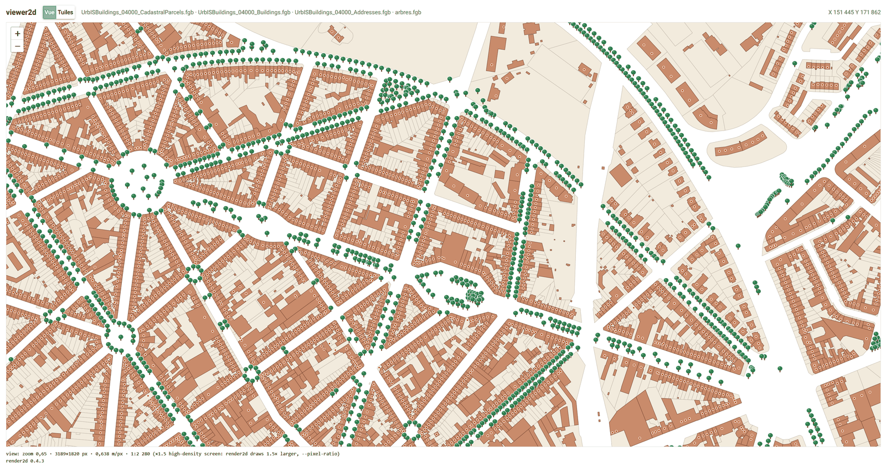

# viewer2d

A test bench for [render2d](../render2d): a map you can pan and zoom with the
mouse. After each move, viewer2d runs `render2d` for the visible area and shows
the image, with render2d's report (scale, counts, timings, warnings) and the
exact command line below the map.



*viewer2d at 1:2,280: parcels, buildings, a dot per door and the street trees.
Brussels, UrbIS data.*

It is a separate project: it only knows render2d's command line, not its code.
Version 1.2 needs **render2d 0.3.8 or later**: render2d reads `viewer.yaml`
itself (`render2d --config viewer.yaml ...`), and viewer2d checks the version
at start.
The design notes are in [`docs/notions.en.html`](docs/notions.en.html).

## Running it

Python 3.10 or later (the Windows Python, not the MSYS2 one), then:

```
pip install -r requirements.txt
python -m viewer2d                       # reads viewer.yaml in the current folder
python -m viewer2d --config other.yaml --port 8081 --no-browser
```

A browser tab opens on http://localhost:8080.

render2d.exe needs its DLLs (GDAL, Cairo, yaml-cpp...): keep
`C:\msys64\ucrt64\bin` in the Windows `PATH`.

## Configuration: `viewer.yaml`

Copy [`viewer.example.yaml`](viewer.example.yaml) to `viewer.yaml` and adapt the
paths: `viewer.yaml` holds the paths of one computer and is not in git. A short
version:

```yaml
render2d: ../render2d/build-release/render2d.exe
layers:                     # drawn in this order, the first at the bottom
  - source: C:/data/parcelles.shp
    style:  ../render2d/styles/parcelles.yaml
  - source: C:/data/batiments.shp      # no style: render2d's built-in one
start:
  bbox: [148000, 168000, 156000, 175000]   # first view, in the data CRS (Lambert 72)
max_parallel: 2             # render2d processes at the same time
tiles: cache/tiles                         # optional: tile mode, cache shared with tiles2d
```

Relative paths are read from the folder of `viewer.yaml` (the same rule as
render2d and editor2d). Two optional keys per layer: `visible: false` (not
drawn at start; unchecked in tile mode) and `title: Bâtiments` (the name shown
in the page). Any other unknown key gives a warning: often a typo.

To tune a style, edit its YSLD file and move the map slightly: every view runs
render2d again, which reads the style again. No restart needed.

## How it works

- The page uses Leaflet with `L.CRS.Simple`: map units are Lambert metres
  (1 m = 1 px at zoom 0). No reprojection, no OpenStreetMap background yet.
- After each move or zoom, the page requests
  `/render.png?xmin=…&ymin=…&xmax=…&ymax=…&w=…&h=…`. The server builds the
  render2d command (`render2d --config viewer.yaml --bbox … --size …`), runs it, and returns the PNG; the report travels in the
  `X-Render2d-Report` header.
- Requests are numbered: only the latest one may replace the image, and the old
  image stays until the new one is loaded (no flicker).
- On a high-density screen, the image is requested with more pixels, so the
  scale reported by render2d is finer than the on-screen one.

## Tile mode

With a `tiles:` line in `viewer.yaml`, a **Vue / Tuiles** switch appears:

- **Vue**: one exact render2d image per view, fractional zooms (to tune a style
  or check a precise scale).
- **Tuiles**: one Leaflet tile layer per data layer, served from the cache
  shared with [tiles2d](../tiles2d) (`cache/<layer>/<key>/z/x/y.png`). Tiles
  that tiles2d pre-computed are served as they are; missing ones are drawn on
  demand, a whole metatile at a time, and kept. Zoom goes by whole levels.

The page checks the cache keys every 2 s: save a style file and its layer
switches to the new pyramid by itself. A layer switch (top right) toggles each
layer and a debug grid. A click on the map shows the tile, its metatile, whether
it is cached, and the exact render2d commands that draw it.

viewer2d reuses tiles2d's grid, cache key and metatile rendering (one
implementation for both). Keep the two folders side by side, as in
`projet_renderer/`, or install it with `pip install -e ../tiles2d`.

## Layout

```
viewer.yaml          configuration
viewer2d/config.py   reading and checking viewer.yaml
viewer2d/render.py   the /render.png route (view mode)
viewer2d/tiles.py    the /tiles/... routes (tile mode, uses tiles2d)
viewer2d/page.py     the NiceGUI page
viewer2d/main.py     command line, assembly, ui.run
static/viewer.js     the Leaflet map
tests/               python tests/test_viewer2d.py
docs/notions.en.html  design notes
```

## License

Copyright (C) 2026 Noël Frankinet.

This program is free software: you can redistribute it and/or modify it under
the terms of the GNU Affero General Public License as published by the Free
Software Foundation, either version 3 of the License, or (at your option) any
later version. See [`LICENSE`](../LICENSE).

It is distributed in the hope that it will be useful, but WITHOUT ANY WARRANTY;
without even the implied warranty of MERCHANTABILITY or FITNESS FOR A
PARTICULAR PURPOSE.

For other licensing terms (for example, use in a closed product or service),
contact the author.
